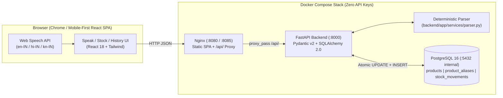
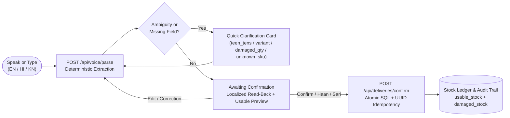
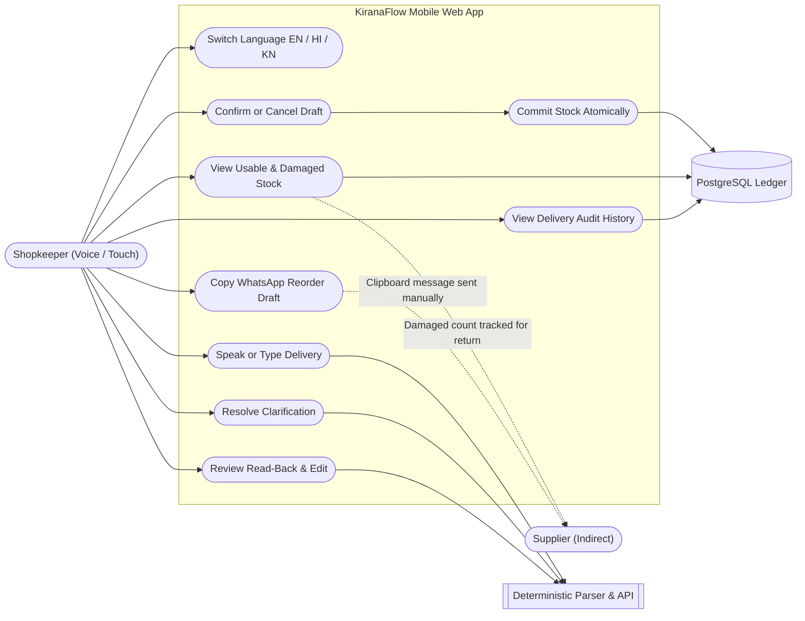
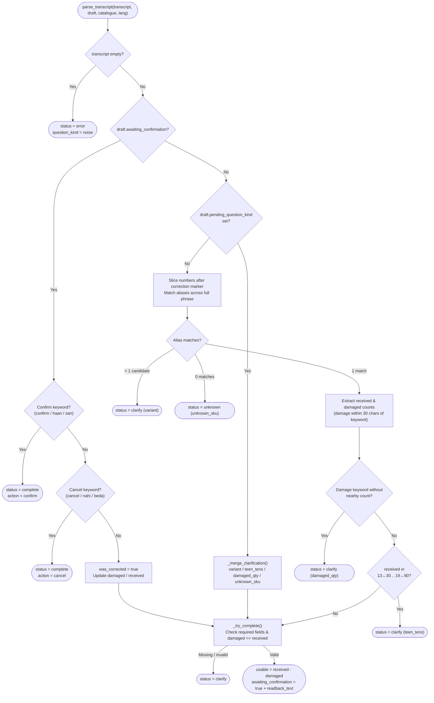

# KiranaFlow

**Voice-first delivery & inventory assistant for Indian kirana stores.**

Built for the Scaler × Wispr Flow Hackathon (Round 2). KiranaFlow lets shopkeepers log supplier deliveries hands-free in **English, Hindi, Kannada, Hinglish, and Kanglish** while managing customers at the counter—separating **usable shelf stock** from **damaged items for supplier return**, catching ambiguous counts (`14` vs `40`) and mid-sentence self-corrections, and **never writing to PostgreSQL until explicitly confirmed**.

---

## System Architecture



---

## Voice Safety & Commit Flow

Every spoken or typed turn is evaluated by the backend state machine; inventory updates execute atomically only after confirmation:



---

## Shopkeeper Delivery Workflows



*Detailed shopkeeper scenarios & workflow specs: [docs/03-use-cases.md](docs/03-use-cases.md)*

---

## How KiranaFlow Parses & Guards Speech



*Frontend state lifecycle & multilingual parser dictionaries: [docs/06-activity-state-machine.md](docs/06-activity-state-machine.md)*

---

## Quick Start

```bash
git clone https://github.com/Ravichandranayakar/kiranaflow.git
cd kiranaflow

# Start PostgreSQL 16, FastAPI, and Nginx (zero API keys needed)
docker compose up --build
```

| Service | URL | Notes |
|---------|-----|-------|
| **Frontend App** | [http://localhost:8080](http://localhost:8080) | Override port if needed: `FRONTEND_PORT=8085 docker compose up --build` |
| **Backend API** | [http://localhost:8000](http://localhost:8000) | Interactive Swagger docs at `/docs` |
| **Health Check** | [http://localhost:8080/api/health](http://localhost:8080/api/health) | Verifies live `SELECT 1` DB connection and active parser mode |
| **Local Vite Dev** | [http://localhost:5173](http://localhost:5173) | Optional dev mode via `cd frontend && npm install && npm run dev` |

> **Voice & Offline Fallback:** Browser voice recognition uses Chrome's Web Speech API (`en-IN` / `hi-IN` / `kn-IN`) with WebRTC noise suppression and automatic `1.5s` silence stop. Every flow also works offline or in any browser via **Or type instead** and the 5 one-tap **Try a test case** chips.

---

## Key Capabilities & Safety Guards

- **Zero External API Keys:** Runs completely locally out of the box (`LLM_API_KEY=""` by default). All alias matching, number extraction, unit mapping (`petis`, `darjan`, `patta`), and state transitions run in deterministic Python ([parser.py](backend/app/services/parser.py)).
- **Confirm-Before-Write Guard:** Spoken confirmation commands (`Confirm`, `Haan`, `Sari`) are ignored outside `awaiting_confirmation`. Nothing touches stock until explicitly confirmed.
- **Mishearing & Correction Protection:** Flags teen/tens ambiguity (`13↔30` through `19↔90`) and resolves mid-sentence self-corrections (e.g., `"actually"`, `"no no"`, `"nahi"`, or Kannada `"illa"`) while keeping the product name from the full sentence.
- **Usable vs. Return Accounting:** Separates sellable `usable_stock` from supplier-claim `damaged_stock` across both `products` and immutable `stock_movements`.
- **Race-Free & Idempotent Commits:** Uses SQL atomic increments (`usable_stock = usable_stock + delta`) and a `UNIQUE` UUID `idempotency_key` so retried requests never double-count.
- **Reorder Drafts & Multilingual UI:** Instant header switching between English (`E`), Hindi (`हि`), and Kannada (`ಕ`), low-stock filtering, and one-click **Copy WhatsApp Reorder Draft** on the **Stock** tab.

---

## Verified Inputs to Test

| Input Phrase | Parsed Outcome |
|--------------|----------------|
| `"24 milk packets bandide 2 odada ide"` | `Nandini Toned Milk 500ml` → `24` received, `2` damaged, `+22` usable |
| `"14 milk packets"` | Triggers `teen_tens` guard → asks `"Did you say 14 or 40?"` |
| `"10 fortune oil illa illa 12 packets 1 leaky"` | `Fortune Sunflower Oil 1L` → drops `10`, keeps `12` received, `1` damaged |
| `"10 cheeni 2 kharab"` | `Loose Sugar 1kg` → `10` received, `2` damaged, `+8` usable |
| `"10 packets amul butter"` | Returns `unknown_sku` without modifying catalogue or stock |

---

## API Endpoints

| Method | Endpoint | Purpose |
|--------|----------|---------|
| `GET` | `/api/health` | PostgreSQL connectivity check (`SELECT 1`) and parser status |
| `POST` | `/api/voice/parse` | Parse utterance against 15 seeded SKUs and echo full `PendingDraft` |
| `POST` | `/api/deliveries/confirm` | Atomically commit confirmed entry and enforce `idempotency_key` |
| `GET` | `/api/stock` | Return current `usable_stock`, `damaged_stock`, and `is_low` status |
| `GET` | `/api/stock/movements` | Return immutable chronological delivery audit log |

Full live-captured request/response JSON payloads are in [docs/08-api-reference.md](docs/08-api-reference.md).

---

## Testing

```bash
# Run standalone deterministic parser unit suite (no Docker or DB required)
python -m pytest backend/tests/ -v
# 33 passed in 0.36s

# Type-check frontend
cd frontend && npx tsc -b --noEmit
```

Full verification results and PostgreSQL idempotency evidence are documented in [docs/09-test-plan-and-results.md](docs/09-test-plan-and-results.md).

---

## Documentation (`docs/`)

| Document | Scope |
|----------|-------|
| [01 — Problem & Solution](docs/01-problem-and-solution.md) | Kirana pain point, voice-first rationale, MVP scope boundaries |
| [02 — Software Requirements (SRS)](docs/02-srs.md) | 12 functional + 6 non-functional requirements traced to source files |
| [03 — Shopkeeper Delivery Workflows](docs/03-use-cases.md) | Shopkeeper, parser, and supplier interaction map (`UC-01`..`UC-10`) |
| [04 — System Architecture](docs/04-architecture.md) | Docker Compose topology, Nginx proxy, and data flow diagrams |
| [05 — Voice & Commit Sequences](docs/05-sequences.md) | Multi-turn `/api/voice/parse` loop & atomic `/api/deliveries/confirm` |
| [06 — State Machine & Speech Parser](docs/06-activity-state-machine.md) | Delivery state machine, `parser.py` decision tree, and EN/HI/KN dictionaries |
| [07 — Data Model](docs/07-data-model.md) | PostgreSQL ER diagram (`db_models.py`) & 15-SKU seed catalogue |
| [08 — API Reference](docs/08-api-reference.md) | Verified live JSON payloads for all 5 endpoints |
| [09 — Test Plan & Results](docs/09-test-plan-and-results.md) | `33 passed` pytest evidence, TypeScript check & idempotency proof |
| [10 — User Guide](docs/10-user-guide.md) | Shopkeeper workflow, language switcher, mic/text modes & settings |
| [11 — Architecture Decisions (ADRs)](docs/11-decisions.md) | 5 key engineering trade-offs & implementation proofs |

---

## Project Structure

```text
kiranaflow/
├── docker-compose.yml            # PostgreSQL 16 + FastAPI + Nginx startup
├── .env.example                  # Optional environment configuration template
├── README.md
├── docs/                         # Architecture, API, schema, test, and ADR docs
├── backend/
│   ├── Dockerfile
│   ├── requirements.txt
│   ├── main.py                   # FastAPI entrypoint & idempotent startup seeding
│   ├── tests/
│   │   └── test_parser.py        # 33 standalone parser unit tests
│   └── app/
│       ├── config.py             # Environment settings
│       ├── db.py                 # SQLAlchemy engine, session & health check
│       ├── models/
│       │   ├── db_models.py      # Product, ProductAlias, StockMovement
│       │   └── schemas.py        # Pydantic v2 API contracts
│       ├── routes/
│       │   ├── voice.py          # POST /api/voice/parse
│       │   └── delivery.py       # POST /api/deliveries/confirm, GET /api/stock*
│       └── services/
│           ├── seed.py           # 15 pre-seeded Indian grocery SKUs + EN/HI/KN aliases
│           ├── catalogue_service.py
│           └── parser.py         # Deterministic multilingual parser & state rules
└── frontend/
    ├── Dockerfile                # Multi-stage Node 20 build -> Nginx runtime
    ├── nginx.conf                # Static SPA + /api/ reverse proxy to backend:8000
    ├── package.json
    └── src/
        ├── App.tsx               # 3-tab mobile-first layout + ErrorBoundary
        ├── hooks/useDeliveryFlow.ts
        ├── services/
        │   ├── api.ts            # Typed fetch client (/api/*)
        │   └── speech.ts         # Web Speech API + Web Audio feedback
        ├── i18n/translations.ts  # Full EN / HI / KN UI translations
        └── components/           # Header, HeroBanner, PendingReceiptCard, MicDial, StockView, HistoryView
```

---

## Tech Stack

| Layer | Technology |
|-------|-----------|
| Backend | Python 3.12, FastAPI 0.115.6, Pydantic v2, SQLAlchemy 2.0, Uvicorn |
| Database | PostgreSQL 16 (`psycopg` v3 binary driver) |
| Frontend | React 18, TypeScript 5.6, Vite 6, Tailwind CSS 3, Lucide Icons |
| Voice Input | Browser Web Speech API (`en-IN`, `hi-IN`, `kn-IN`) + WebRTC mic constraints |
| Voice Output | Browser Web Speech Synthesis + Web Audio feedback chimes |
| Runtime | Docker & Docker Compose (`db`, `backend`, `frontend` via Nginx) |
