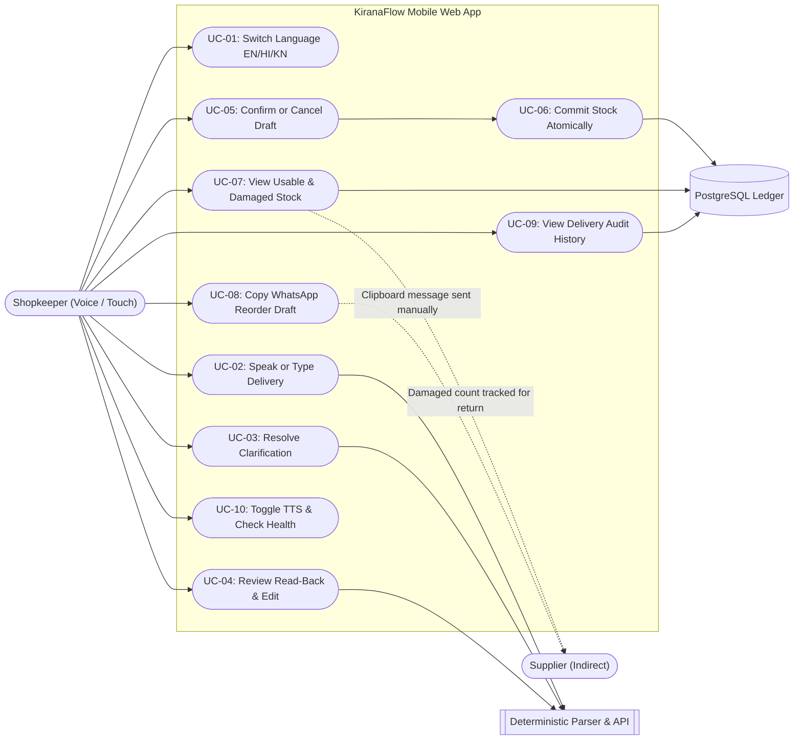

# 03 — Use Cases

## 1. System Use-Case Diagram

Standard GitHub Mermaid renders actors and system boundary cleanly via `flowchart LR`:

---

## 2. Core Use-Case Specifications

| ID | Use Case | Trigger & Primary Flow | Verification |
|----|----------|------------------------|--------------|
| **UC-01** | Switch Language (Anytime) | Shopkeeper taps `E`, `हि`, or `ಕ` in `Header` — even midway during review. All UI labels (`translations.ts`), badges, units, card read-backs, clarification prompts, and spoken TTS output update immediately while still accepting EN/HI/KN mixed input. | Live header toggle |
| **UC-02** | Speak / Type Delivery | Tap `MicDial` (requests WebRTC `noiseSuppression`, `echoCancellation`, `autoGainControl` via standard `MediaRecorder`), speak casually (`"5 magi"`, `"10 atta"`, `"24 milk packets bandide 2 odada ide"`), or tap **Or type instead** / `ExampleStrip` (6 chips). Web Audio VAD stops `1.0s` after speech ends (`7s` no-voice cutoff) and sends audio to `POST /api/voice/intake`. | `useDeliveryFlow.ts` |
| **UC-03** | Resolve Ambiguity / "Both" | When `POST /api/voice/parse` returns `status="clarify"` or `"unknown"`, UI renders `PendingReceiptCard` options: `teen_tens` 2-button grid (`14` vs `40`), candidate cards + **Select All / Both** (`variant` or saying `"both"`), quick quantity pills (`received_qty`), quick pills `0..5` (`damaged_qty`), or catalogue chips (`unknown_sku`). | `test_parser.py` |
| **UC-04** | Review Read-Back & Hands-Free Edit | When `status="complete"`, app highlights `+usable` in chartreuse, speaks localized `readback_text` via `speechSynthesis`, and on voice turns **automatically re-opens the mic (`350ms` after speech ends)** alongside an inline **Speak “OK / Confirm” or Edit** button so the user can speak corrections (`"28 packets and 3 damaged"`, `"maggi 12"`) or tap **Edit details**. | `PendingReceiptCard.tsx` |
| **UC-05** | Confirm or Cancel (Hands-Free or Tap) | Tap **Confirm & Save** or speak `"OK"`, `"Ya confirm"`, `"Confirm"`, `"Haan"`, `"Houdu"`, or `"Sari"` during the active review. Cancel clears `PendingDraft` back to `IDLE`. Spoken confirm/cancel is ignored outside `awaiting_confirmation`. | `test_confirm_only_when_awaiting` |
| **UC-06** | Atomic Commit | Frontend sends `POST /api/deliveries/confirm` (or `/confirm-batch` for multi-item deliveries) with UUID `idempotency_key`. Backend updates `products` atomically and appends `stock_movements`, playing Web Audio success chime and showing **Committed** receipt. | Live DB + duplicate test |
| **UC-07** | Manage Stock & Return Claims | Open **Stock** tab; filter `All`, `Low`, or `Damaged`. Each row separates sellable **Usable** count from **Return** (`damaged_stock`), and supports manual `+`/`-` adjustments (`POST /api/stock/adjust`) plus explicit **Add Item** / delete SKU (`POST/DELETE /api/stock/products`). | `StockView.tsx` |
| **UC-08** | Draft WhatsApp Reorder | When `low_stock_count > 0`, tapping **Copy WhatsApp Reorder Draft** copies formatted item list (`- Name (only X left)`) to clipboard. | `StockView.tsx` |
| **UC-09** | Audit Movement History | Open **History** tab to inspect chronological entries with `raw_transcript`, `lang`, `source`, `+usable_delta`, `damaged`, and `CORRECTED` badge. | `HistoryView.tsx` |
| **UC-10** | Settings & Diagnostics | Tap gear icon in `Header` to mute/unmute spoken TTS and inspect `/api/health` (`database`, `llm_parser`, optional key field). | `SettingsModal.tsx` |
