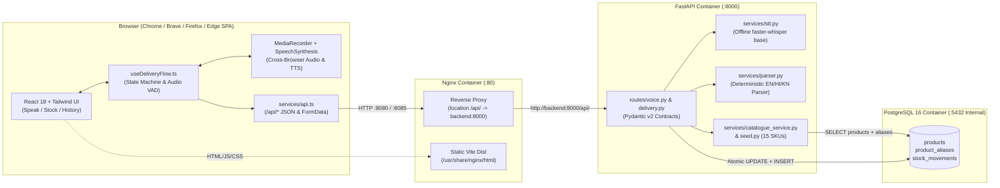
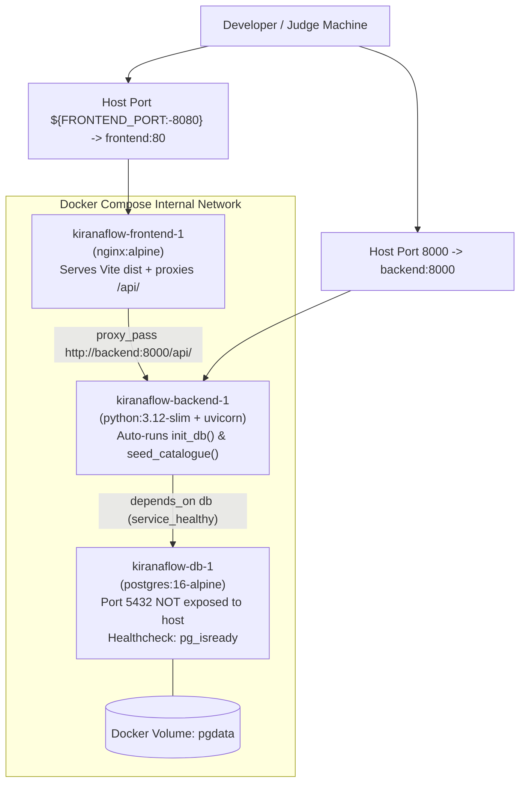
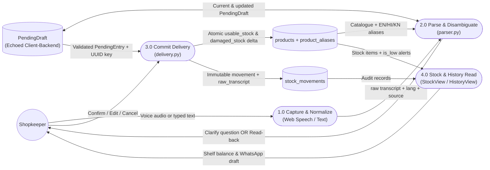

# 04 — System Architecture & Deployment

## 1. System Architecture

KiranaFlow uses a three-tier client–server architecture where **all linguistic interpretation and draft state merging live on the Python backend**, leaving React strictly as a typed voice/touch presentation layer. Zero external LLM API keys are required.

---

## 2. Docker Deployment Topology

From [`docker-compose.yml`](../docker-compose.yml) and [`frontend/nginx.conf`](../frontend/nginx.conf):

### Deployment Highlights

- **Single startup command:** `docker compose up --build` initializes schema (`init_db()`), seeds 15 Indian grocery SKUs + multilingual aliases (`seed_catalogue()`), starts FastAPI, and serves the compiled SPA through Nginx.
- **No host port 5432 collision:** `db` publishes `5432/tcp` only within the internal Compose network, preventing conflicts with local PostgreSQL installations.
- **Configurable frontend port:** Defaults to `8080` and supports overrides such as `FRONTEND_PORT=8085` when port `8080` is occupied.
- **Local Vite dev mode:** `frontend/vite.config.ts` listens on `:5173` and proxies `/api` to `http://127.0.0.1:8000` (with 60s proxy timeout) for rapid frontend iteration while backend + Postgres remain in Docker.

---

## 3. Level-0 Data Flow Diagram (DFD)

---

## 4. Module Responsibilities

| Module | Path | Responsibility |
|--------|------|----------------|
| App Entry & Lifespan | `backend/main.py` | Creates tables, runs idempotent seed, attaches CORS + routes, serves `/api/health` |
| Config | `backend/app/config.py` | Loads `DATABASE_URL`, `CORS_ORIGINS`, `LLM_API_KEY`, `DEFAULT_LANGUAGE` |
| ORM Models | `backend/app/models/db_models.py` | Defines `Product`, `ProductAlias`, and `StockMovement` |
| API Schemas | `backend/app/models/schemas.py` | Pydantic v2 validation for `/api/voice/intake`, `/api/voice/parse`, `/api/deliveries/confirm*`, `/api/stock*` |
| Deterministic Parser | `backend/app/services/parser.py` | Pure-Python single/multi-item extraction, 3-tier short/fuzzy SKU match, `"both"` queuing, `received_qty`, self-correction, teen/tens & variant guards |
| Seed & Catalogue | `backend/app/services/seed.py`, `catalogue_service.py` | Idempotently seeds 15 SKUs + opening stock, syncs aliases, and loads catalogue with eager joins |
| Voice & Delivery Routes | `backend/app/routes/voice.py`, `delivery.py` | Offline Whisper transcription, single-hop intake, idempotency checks, atomic SQL updates, manual adjustments & SKU CRUD |
| Frontend Flow Hook | `frontend/src/hooks/useDeliveryFlow.ts` | Finite state machine, `1.0s` post-speech VAD timer (`12.5 Hz`), `350ms` post-TTS hands-free follow-up mic, `7s` no-voice cutoff, `isConfirmingRef` lock |
| Speech & i18n | `frontend/src/services/speech.ts`, `i18n/translations.ts` | Cross-browser `MediaRecorder`, `onend`-aware `speechSynthesis`, `hasBrowserVoice()`, live midway read-backs & UI localization |
