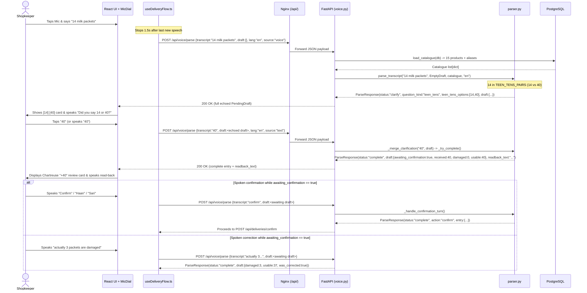
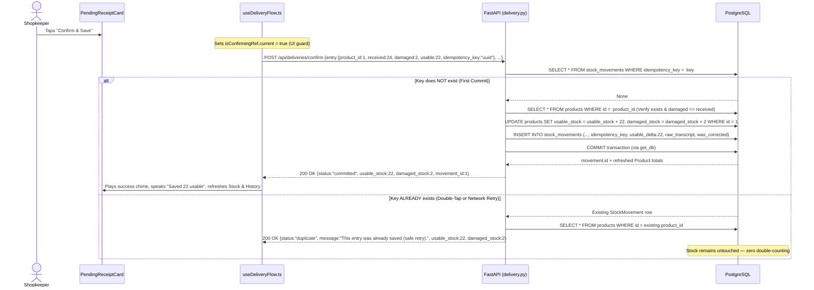

# 05 — Sequence Diagrams

## 1. Voice / Text Parse & Clarification Loop (`POST /api/voice/parse`)

Every spoken or typed turn passes through the same backend parser. The frontend sends `{ transcript, draft, lang, source }` and renders the returned `draft` verbatim without local parsing or merging.

---

## 2. Delivery Confirmation, Atomic Update & Idempotency (`POST /api/deliveries/confirm`)

Once the shopkeeper taps **Confirm & Save** or speaks `"Confirm"`, a UUID `idempotency_key` generated in the draft guarantees that accidental double-taps or network retries never double-increment inventory.

