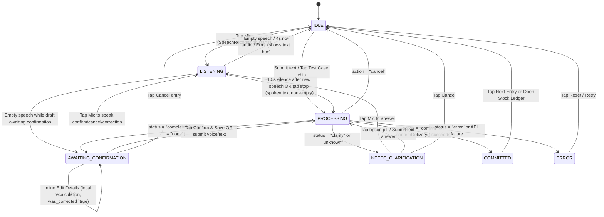
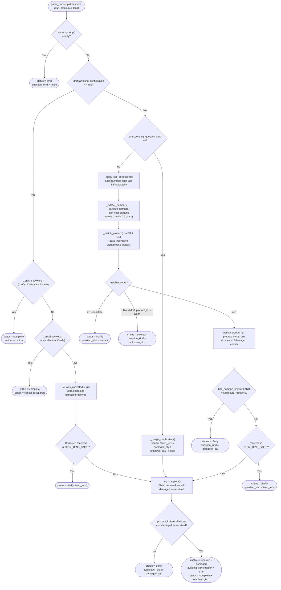

# 06 — State Machine & Deterministic Parser Activity Flow

## 1. Frontend Delivery Flow State Machine (`useDeliveryFlow.ts`)

---

## 2. Backend Parser Activity Diagram (`parser.py`)

This mirrors the exact execution order inside `parse_transcript()` in [`backend/app/services/parser.py`](../backend/app/services/parser.py):

---

## 3. Verified Rule Dictionaries (`parser.py`)

| Rule Category | Values Implemented |
|---------------|--------------------|
| **Correction markers** | `illa`, `illa illa`, `no no`, `nahi`, `nahi nahi`, `actually`, `wait`, `sorry`, `correction`, `arbeider`, `not`, `i mean`, `matlab` |
| **Damage keywords** | `damaged`, `damage`, `broken`, `leaky`, `leak`, `leaked`, `spoiled`, `spoilt`, `expired`, `torn`, `crushed`; **HI:** `kharab`, `toota`, `tuta`, `phoota`, `phuta`, `fataa`, `sadaa`; **KN:** `odada`, `odeda`, `haalada`, `tutela`, `ketalada` |
| **Confirm / Cancel** | **Confirm:** `confirm`, `confirmed`, `yes`, `haan`, `ha`, `sari`, `seri`, `ok`, `okay`, `done`, `save`; **Cancel:** `cancel`, `cancelled`, `no`, `nahi`, `beda`, `bedi`, `skip`, `discard`, `chhodo` |
| **Colloquial units** | `packet`/`pack`→`packets`, `peti`/`petis`/`crate`→`crates`, `kg`/`kilo`/`kilogram`→`kg`, `bottle`→`bottles`, `piece`→`pieces`, `darjan`/`darzen`/`dozen`→`dozens`, `patta`→`leaves`, `bag`, `tray`, `box` |
| **Teen/Tens guard** | Bidirectional pairs: `13↔30`, `14↔40`, `15↔50`, `16↔60`, `17↔70`, `18↔80`, `19↔90` |
| **Number words** | English (`zero`..`hundred` + common compounds), Hindi (`ek`..`sau`), Kannada (`ondu`..`nooru`) |
