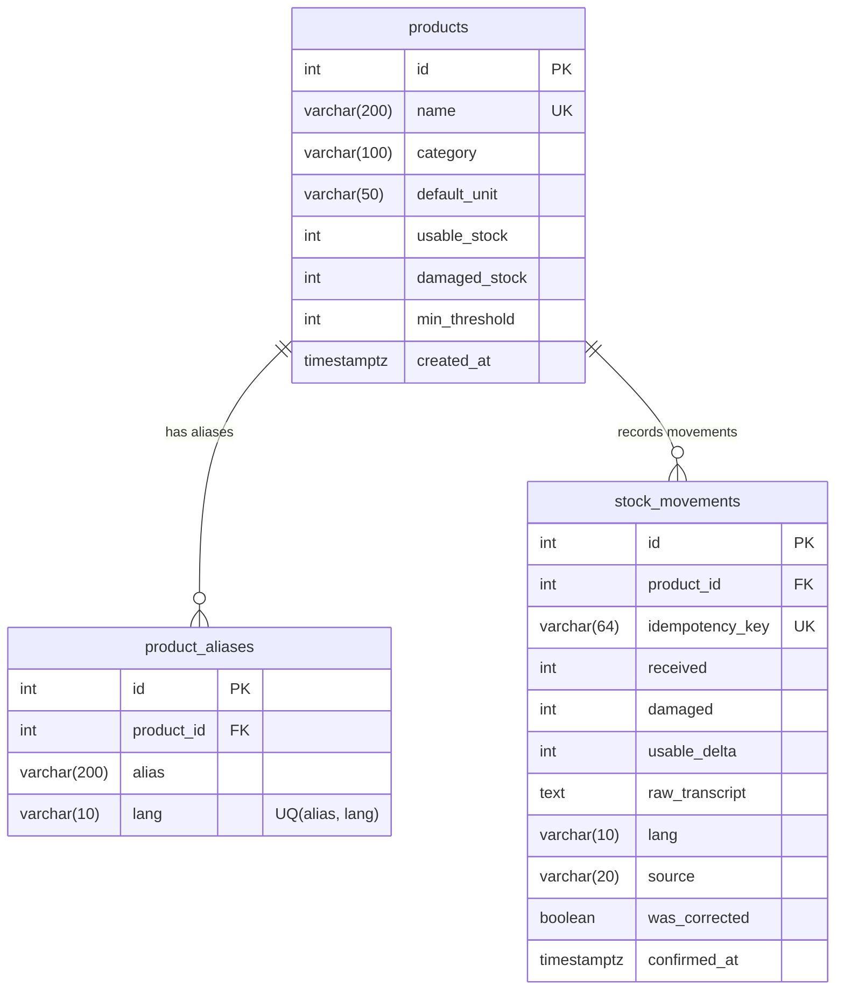

# 07 — Data Model & Schema

## 1. Entity–Relationship Diagram

Generated directly from [`backend/app/models/db_models.py`](../backend/app/models/db_models.py):

---

## 2. Table Definitions & Constraints

### `products`

| Column | Type | Constraints / Default | Purpose |
|--------|------|------------------------|---------|
| `id` | `Integer` | `PRIMARY KEY, autoincrement` | Internal SKU ID |
| `name` | `String(200)` | `NOT NULL, UNIQUE` | Canonical SKU label (e.g., `"Nandini Toned Milk 500ml"`) |
| `category` | `String(100)` | `NOT NULL, default "general"` | Shelf group (`dairy`, `staples`, `oil`, `snacks`, etc.) |
| `default_unit` | `String(50)` | `NOT NULL, default "packets"` | Fallback unit when omitted in speech |
| `usable_stock` | `Integer` | `NOT NULL, default 0` | Sellable shelf inventory |
| `damaged_stock` | `Integer` | `NOT NULL, default 0` | Broken/leaking items segregated for supplier return |
| `min_threshold` | `Integer` | `NOT NULL, default 5` | Low-stock alert trigger (`usable_stock < min_threshold`) |
| `created_at` | `DateTime(tz)` | `NOT NULL, UTC now` | Record creation timestamp |

### `product_aliases`

| Column | Type | Constraints / Default | Purpose |
|--------|------|------------------------|---------|
| `id` | `Integer` | `PRIMARY KEY, autoincrement` | Alias row ID |
| `product_id` | `Integer` | `FK -> products.id (ON DELETE CASCADE)` | Linked product |
| `alias` | `String(200)` | `NOT NULL` | Lowercased phonetic/colloquial alias (e.g., `"haalu"`, `"doodh"`) |
| `lang` | `String(10)` | `NOT NULL, default "en"` | Language tag (`en`, `hi`, `kn`) |
| — | `UniqueConstraint` | `uq_alias_lang (alias, lang)` | Prevents duplicate alias strings within a language |

### `stock_movements`

| Column | Type | Constraints / Default | Purpose |
|--------|------|------------------------|---------|
| `id` | `Integer` | `PRIMARY KEY, autoincrement` | Immutable audit ID |
| `product_id` | `Integer` | `FK -> products.id (ON DELETE CASCADE)` | Target SKU |
| `idempotency_key` | `String(64)` | `NOT NULL, UNIQUE` | Per-draft UUID preventing double-commits on retry/double-tap |
| `received` | `Integer` | `NOT NULL` | Total delivered units stated |
| `damaged` | `Integer` | `NOT NULL, default 0` | Damaged count logged for supplier return |
| `usable_delta` | `Integer` | `NOT NULL` | Net shelf addition (`received - damaged`) |
| `raw_transcript` | `Text` | `NULLABLE` | Verbatim spoken/typed utterance |
| `lang` | `String(10)` | `NOT NULL, default "en"` | Active UI/parse language |
| `source` | `String(20)` | `NOT NULL, default "voice"` | Capture channel (`voice`, `text`, `demo`) |
| `was_corrected` | `Boolean` | `NOT NULL, default False` | Tracks whether shopkeeper edited/corrected before confirm |
| `confirmed_at` | `DateTime(tz)` | `NOT NULL, UTC now` | Server commit timestamp |

---

## 3. Atomic Write & Pre-Seeded 15-SKU Catalogue

All inventory updates in [`backend/app/routes/delivery.py`](../backend/app/routes/delivery.py) execute atomic SQL expressions (`Product.usable_stock + usable_delta` and `Product.damaged_stock + entry.damaged`) inside a database transaction (`get_db()`).

On first startup (`seed_catalogue()` in [`backend/app/services/seed.py`](../backend/app/services/seed.py)), 15 common Indian kirana SKUs and EN/HI/KN phonetic aliases are inserted idempotently:

| Product | Category | Unit | Threshold | Sample Aliases (EN / HI / KN) |
|---------|----------|------|-----------|-------------------------------|
| `Nandini Toned Milk 500ml` | `dairy` | `packets` | `10` | `milk`, `doodh`, `haalu` |
| `Loose Sugar 1kg` | `staples` | `kg` | `5` | `sugar`, `cheeni`, `sakre` |
| `Aashirvaad Atta 1kg` | `staples` | `packets` | `5` | `aashirvaad 1kg`, `atta chhota`, `aashirvaad atta sanna` |
| `Aashirvaad Atta 5kg` | `staples` | `packets` | `3` | `aashirvaad 5kg`, `atta bada`, `aashirvaad atta dodda` |
| `Parle-G Biscuit Small` | `snacks` | `packets` | `20` | `parle g`, `parle g chhota`, `parle g sanna` |
| `Fortune Sunflower Oil 1L` | `oil` | `bottles` | `5` | `fortune oil`, `tel`, `enne` |
| `Toor Dal 1kg` | `pulses` | `kg` | `5` | `toor dal`, `daal`, `togari bele` |
| `Tata Salt 1kg` | `staples` | `packets` | `5` | `salt`, `namak`, `uppu` |
| `Colgate Toothpaste 100g` | `personal care` | `pieces` | `5` | `colgate`, `toothpaste` |
| `Maggi Noodles 70g` | `instant food` | `packets` | `15` | `maggi`, `noodles` |
| `Daawat Basmati Rice 1kg` | `staples` | `kg` | `5` | `rice`, `chawal`, `akki` |
| `Onion 1kg` | `produce` | `kg` | `10` | `onion`, `pyaaz`, `eerulli` |
| `Potato 1kg` | `produce` | `kg` | `10` | `potato`, `aloo`, `aaloogadde` |
| `Eggs (12 pack)` | `dairy` | `dozens` | `5` | `eggs`, `anda`, `motte` |
| `Surf Excel Detergent 500g` | `cleaning` | `packets` | `5` | `surf excel`, `dhulai powder`, `washing powder` |
